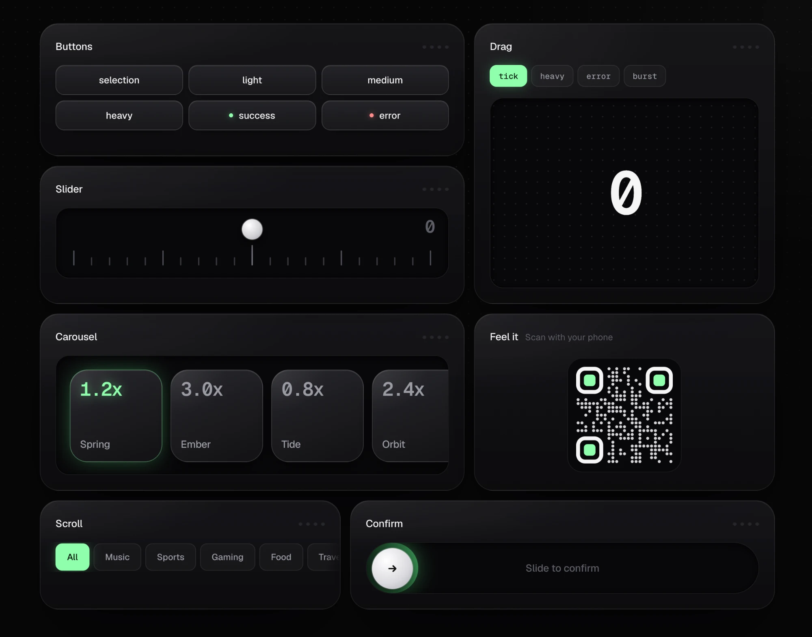

# haptick

**Real haptic feedback for the mobile web, including iPhone.**

<a href="https://jcruzfff.github.io/haptick/"></a>

Haptics for taps and drags in iOS Safari and on Android, with no
dependencies.

## Install

```sh
npm install haptick
```

## Run it locally

```sh
git clone https://github.com/jcruzfff/haptick.git
cd haptick
pnpm install
pnpm dev
```

`pnpm dev` prints two addresses. Open the **phone** one on a phone on the same
Wi-Fi to feel the haptics; desktops can't vibrate.

## License

MIT
